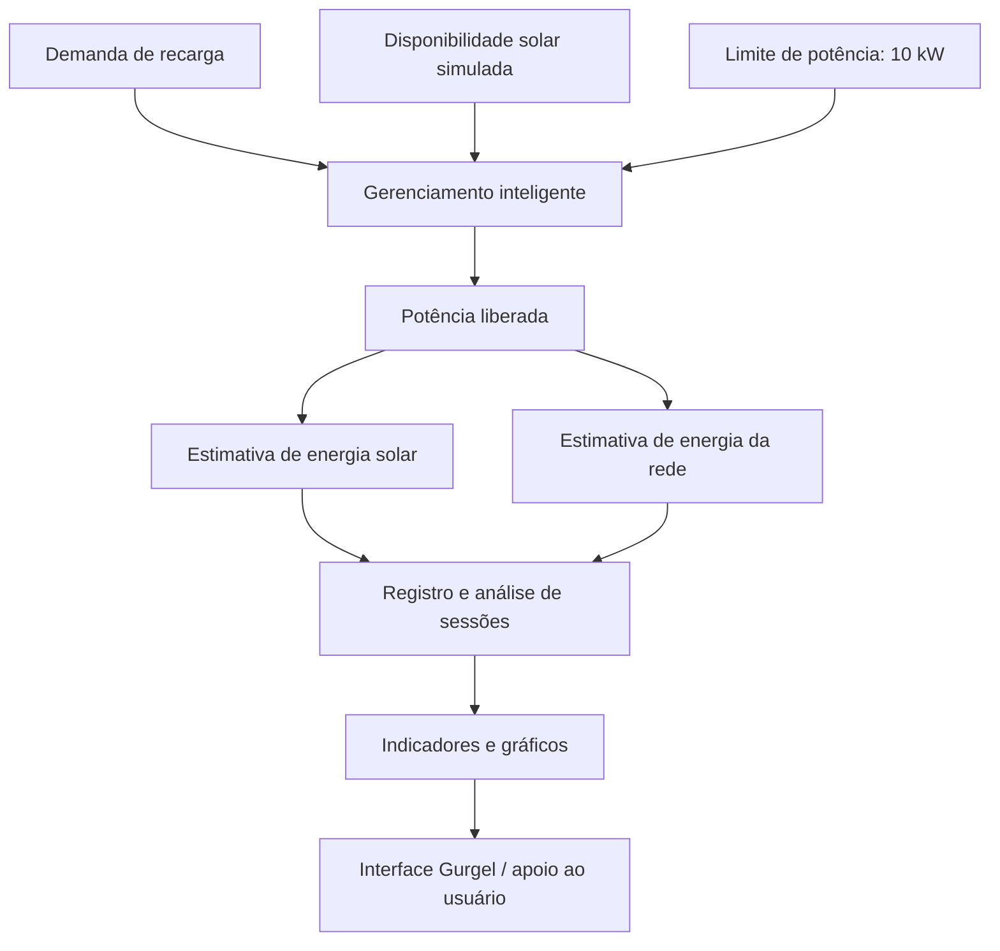
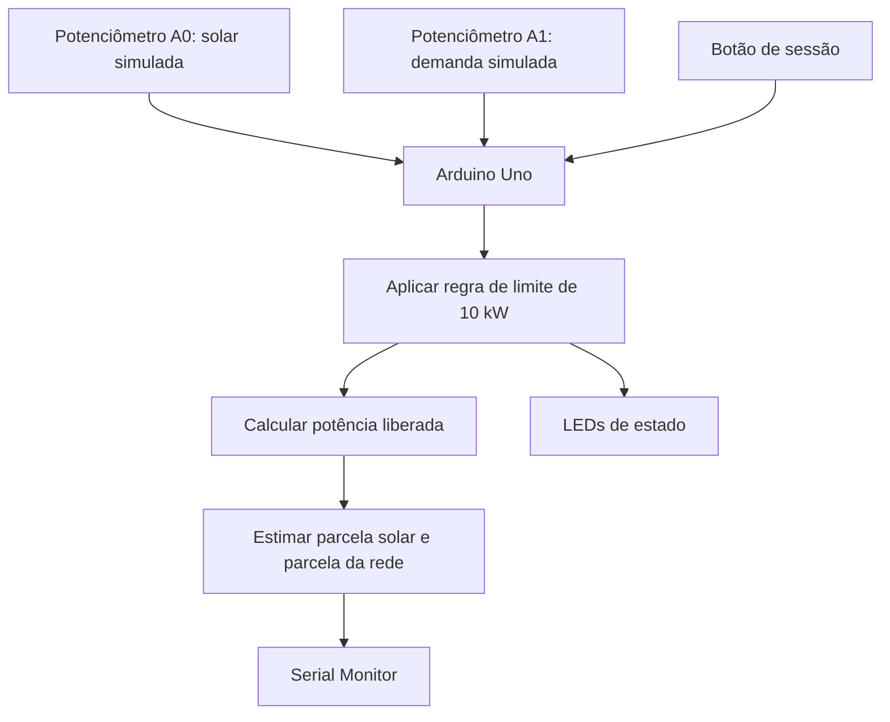
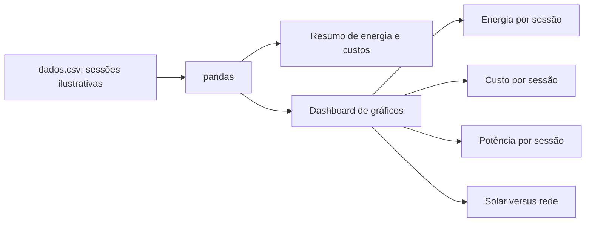

# Diagramas e telas — Gurgel Sprint 4

Este documento reúne o fluxo funcional documentado e imagens demonstrativas do projeto. As imagens de interface foram reutilizadas do repositório da Sprint 3 para preservar o material já produzido pela equipe.

## 1. Arquitetura conceitual do Gurgel

**Nota:** o diagrama é conceitual. Os arquivos atuais não demonstram integração automática entre o Arduino, os scripts Python e a interface. A energia solar é simulada no circuito com potenciômetro.

## 2. Fluxo do protótipo Arduino

## 3. Fluxo de análise de dados

## 4. Capturas de telas do projeto

### Protótipo de hardware

### Interface do GurAI

### Conversa com GurAI

### Mapa de carregadores

### Monitoramento e mapa

### Reserva de carregador

### Reservas

As imagens de interface registram telas já existentes no material da Sprint 3; não devem ser interpretadas como evidência de que pagamentos, reservas ou controle de hardware estejam integrados e operacionais, a menos que a equipe tenha demonstrado esses fluxos no vídeo final.
